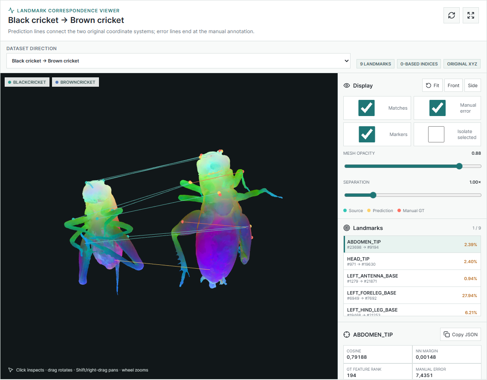

# Diff3F App

A local web app for the [Diff3F on BugNIST](https://github.com/pabloArce2/bugnist-diff3f-features) pipeline. Every step
of the pipeline (CT preview, segmentation, smoothing, Diff3F descriptors, matching, landmark
benchmark) has a form; the app runs the corresponding Python script of the backend as a
background job and shows its log. Two 3D viewers show meshes coloured by their descriptors
and the landmark correspondences between two specimens.



The app is a thin layer over the backend: it does not compute anything itself. If you want
to understand what the steps do, read [docs/how-the-backend-works.md](docs/how-the-backend-works.md).

## Requirements

- The backend, [bugnist-diff3f-features](https://github.com/pabloArce2/bugnist-diff3f-features),
  with its `diff3f` conda environment set up
  ([installation](https://github.com/pabloArce2/bugnist-diff3f-features/blob/main/docs/installation.md)).
- Node.js 20 or newer.
- An NVIDIA GPU for the descriptor step (everything else runs on the CPU).
- Blender, only for the "Blender correspondence scene" step.

## Install and run

Clone both repositories into the same folder; the app looks for the backend next to itself:

```bash
git clone https://github.com/pabloArce2/bugnist-diff3f-features.git
git clone https://github.com/pabloArce2/Diff3f_App.git
cd Diff3f_App
npm install
npm run dev
```

and open <http://127.0.0.1:5180>. The server prints which backend folder, Python and Blender
it found:

```text
BugNIST pipeline app running at http://127.0.0.1:5180
Diff3F root: ...\bugnist-diff3f-features
Python: ...\envs\diff3f\python.exe
Blender: C:\Program Files\Blender Foundation\Blender 5.2\blender.exe
```

The sidebar shows the same status. `npm run dev` serves the front end through Vite with hot
reload; for a built version, run `npm run build` once and then `npm start`.

## Configuration

Everything is found automatically in the usual places. Override it with environment
variables when needed:

| Variable | Default |
| --- | --- |
| `DIFF3F_ROOT` | `../bugnist-diff3f-features`, or `../Diffusion-3D-Features` |
| `DIFF3F_PYTHON` | `python` of the conda env named `DIFF3F_ENV` (default `diff3f`), looked up in the active env, next to `conda`, and in `~/miniconda3`, `~/anaconda3`, `~/miniforge3` |
| `BLENDER_EXE` | newest `C:\Program Files\Blender Foundation\Blender *\blender.exe`, or `blender` on `PATH` |
| `HOST`, `PORT` | `127.0.0.1`, `5180` |

```powershell
$env:DIFF3F_ROOT = "D:\projects\bugnist-diff3f-features"; npm run dev
```

The server only listens on localhost and only reads and serves files inside the backend
folder. Keep it that way: the API can start arbitrary pipeline jobs.

## Pages

| Page | What it runs |
| --- | --- |
| Data | upload files (saved in the backend's `pipeline_app_uploads/`), list and download project files |
| CT Preview | `preview_tif_volume.py` |
| Geometry | `bugnist_tif_to_mesh.py`, `smooth_simplify_mesh.py`, `bugnist_tif_to_pointcloud.py` |
| Descriptors | `compute_mesh_features.py`, `compute_pointcloud_features.py`, and the PCA colour export (`visualize_mesh_features.py` / `visualize_pointcloud_features.py`) |
| Visualize | the mesh viewer and the correspondence viewer (no jobs) |
| Match | `compute_feature_correspondences.py`, `make_blender_correspondence_scene.py` |
| Benchmark | `evaluate_landmark_benchmark.py`, `debug_2d_diffusion_view.py` |
| Jobs | running and finished jobs, their full command, log and output files |
| Docs | the settings used in the project |

Paths in the forms are relative to the backend folder; the folder button next to each field
opens a file browser restricted to that folder. [docs/user-guide.md](docs/user-guide.md) goes
through every page.

## Documentation

- [docs/how-the-backend-works.md](docs/how-the-backend-works.md): how an insect is cut out
  of a CT scan and turned into a mesh, how descriptors are computed, and which script each
  page calls.
- [docs/user-guide.md](docs/user-guide.md): using the app, from a first test with the camel
  mesh to a full cricket run.
- [docs/correspondence-datasets.md](docs/correspondence-datasets.md): adding your own
  benchmark results to the correspondence viewer.

## Tests

```bash
npm test             # unit tests for the preset loader (no data needed)
npm run test:smoke   # browser tests against the running app
```

The smoke tests drive a running app (`npm run dev` in another terminal) with Playwright and
expect the project's cricket data in the backend folder. Install Playwright's browser once
with `npx playwright install chromium`, or set `PLAYWRIGHT_CHANNEL=msedge` to use Edge.
`APP_URL` points them at another address.

## Layout

```text
server/index.mjs                  Express server: API, job runner, Vite middleware
server/tools.mjs                  finds Python and Blender, sets up the conda PATH for jobs
server/correspondence-presets.mjs loads the datasets of the correspondence viewer
src/App.vue                       the pipeline forms and job list
src/components/PcaMeshViewer.vue  mesh / point-cloud viewer with a file explorer
src/components/CorrespondenceViewer.vue  two-shape landmark viewer
src/components/ProjectPathInput.vue      path field with a file browser
src/lib/ViewerControls.js         camera controls shared by both viewers
tests/                            unit and browser tests
```
