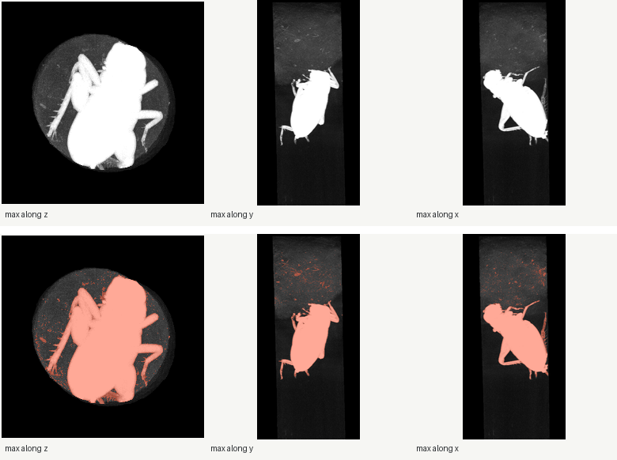
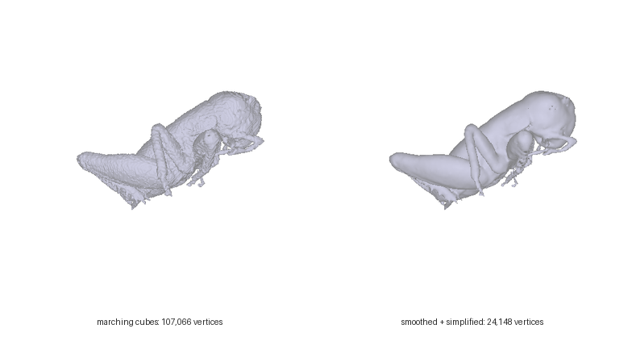
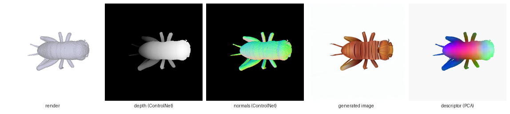
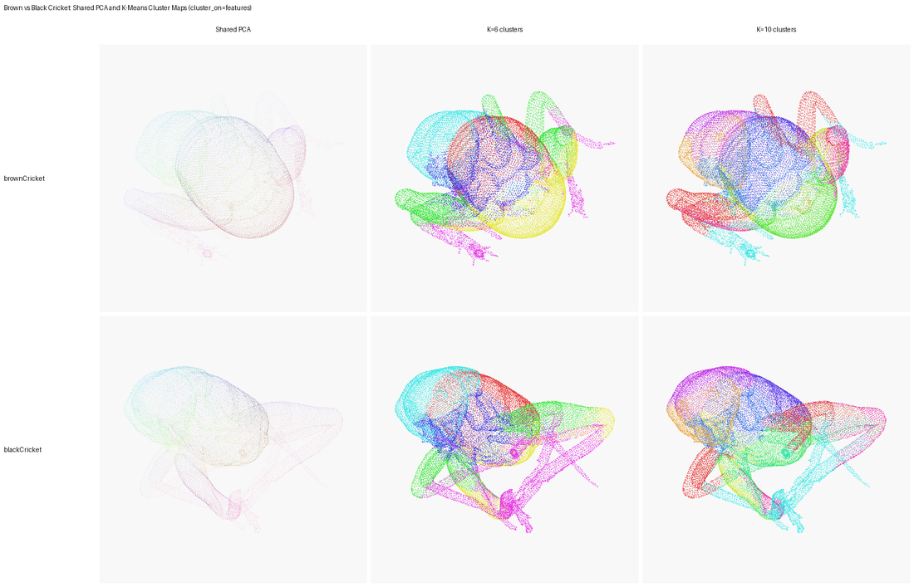

# How the backend works

The app does not process anything itself. Each button starts one of the Python scripts in
the backend repository, [Diff3F on BugNIST](https://github.com/pabloArce2/bugnist-diff3f-features),
with the values from the form as command-line arguments. This page explains what those
scripts do, in the order you normally run them:

```text
CT scan (.tif)
  -> separate the insect from everything else        CT Preview, Geometry
  -> surface mesh (or point cloud)                   Geometry
  -> smooth, simplify, rotate                        Geometry (+ Blender)
  -> Diff3F descriptor per vertex (.pt)              Descriptors
  -> compare specimens                               Visualize, Match, Benchmark
```

The backend's own documentation has the full details and every option; the links are at the
end of each section.

## 1. The scans

[BugNIST](https://arxiv.org/abs/2304.01838) is a dataset of X-ray CT scans of insects and
larvae. Each scan is a 512 x 256 x 256 block of voxels (about 32 MB) whose values, 0-255,
measure how much X-ray was absorbed. The insect's cuticle is bright, air is dark, and in
between there is soft tissue, the cotton or foam holding the specimen in its tube, and some
noise. The volumes are stored as TIFF stacks and indexed (Z, Y, X), with Z the long axis.

Diff3F needs a surface, so the first job is to find which voxels belong to the insect.

## 2. Separating the insect from the scan



*The brown cricket `bcrick_10_010`: maximum-intensity projections along the three axes
(top), and the voxels above the threshold of 45 in red (bottom). CT Preview makes these
images.*

The segmentation is classical image processing, no neural network. It happens in four steps.

**Crop.** Cut a box around the insect, so the tube wall and packing at the edges do not
matter. Either give the box in voxel indices (*ROI start* and *ROI size*, both Z Y X), or
tick *Auto-crop*, which thresholds once and takes the bounding box of the result plus a
margin (*Auto-crop padding*).

**Threshold.** Every voxel brighter than the threshold becomes "insect". The threshold was
chosen by looking at the CT Preview overlays and histogram: high enough that the cotton
disappears, low enough that the thin legs and antennae stay. Otsu's automatic method is
available too, but a scan contains more than two materials and Otsu often picks a value
that is much too strict. The project used values between 11 and 75, depending on the scan.

**Clean.** The thresholded mask still contains specks and fibres. The cleaning steps remove
pieces smaller than *Minimum component size* (512 voxels), optionally break thin bridges
(*Opening radius*) or close small gaps (*Closing radius*), and *Fill holes* fills the cavities
inside the body; otherwise the air inside the insect would produce a second, inner surface.

**Keep the largest piece.** Finally the mask is split into connected components and only
the largest one is kept (*Keep largest*). This is what really separates the insect from
leftover debris: whatever is not connected to the insect is dropped.

The settings used for the specimens in the project:

| Specimen | Scan | Threshold | Crop | Fill holes |
| --- | --- | --- | --- | --- |
| brown cricket | `bcrick_10_010` | 45 | auto-crop | yes |
| black cricket | `sfaar_10_010` | 45 | auto-crop | yes |
| mealworm | `mel_10_002` | 75 | auto-crop | yes |
| soldier fly larva | `soldat_10_002` | 28 | ROI 72 60 73, size 358 171 123 | yes |

Details: [ct-to-mesh.md](https://github.com/pabloArce2/bugnist-diff3f-features/blob/main/docs/ct-to-mesh.md).

## 3. From voxels to a surface

The cleaned mask is a 3D array of zeros and ones. *Create mesh* runs marching cubes on it,
which places a triangle surface exactly where the mask changes from 0 to 1. The vertices are
moved back into the coordinates of the full scan (undoing the crop) and saved as OBJ, in
voxel units. For the brown cricket this gives about 120,000 vertices.

*Create point cloud* does the same segmentation and then samples a fixed number of points
(normally 20,000) on that surface instead of keeping the triangles.

## 4. Cleaning up the mesh



A marching-cubes surface follows the voxel grid, so it is covered in small stair-steps, and
it is much denser than the meshes Diff3F was developed on. *Smooth And Simplify Mesh* first
applies Taubin smoothing (10 iterations), which removes the steps without shrinking the thin
legs, then reduces the mesh to about 50,000 faces by merging nearby vertices, and smooths
3 more iterations. The anatomy survives, the descriptor looks the same, and each camera view
is processed 40-55 % faster.

Then each specimen is rotated to a common pose in Blender (rotate, *Apply > Rotation*, export
OBJ), because the cameras in the next step are placed in world coordinates: without it, the
same camera would look at the side of one insect and the end of another.

After this step the geometry must not change any more. A descriptor has one row per vertex,
in file order, so it only fits the exact file it was computed from.

## 5. Descriptors



*Compute mesh descriptors* runs Diff3F. For each of the camera views (16 in the project) it:

1. renders the grey mesh, plus a depth map and a normal map,
2. lets Stable Diffusion 1.5 paint the render, guided by the prompt and by the depth and
   normal maps through two ControlNets, so the painted insect keeps the shape of the mesh,
3. reads two feature maps: the diffusion UNet's internal activations while painting, and
   DINOv2's features of the finished image,
4. glues them into one 2048-number vector per pixel,
5. projects each pixel back to the vertices it came from.

Every vertex ends up with the average of the vectors it received from all views; vertices no
camera saw copy their nearest seen neighbour. The result is saved as
`output/<folder>/<mesh name>_diff3f.pt`, a table with one row per vertex and 2048 columns.
Vertices on similar body parts get similar rows, even on different specimens. That is the
whole idea.

The form's options map directly onto this: *Prompt* (the only semantic input, e.g. "cricket
insect, full body, long antennae, ..."), *Views* and *Sampling* (where the cameras go;
`insect` puts most of them around the sides of the body), *Height / Width* (the render size,
512 is Stable Diffusion's native size) and *Tolerance* (how far from a pixel's 3D position a
vertex may be and still receive it). *Capture images from this descriptor run* saves the
render and generated image of every view, which is the best way to check that the model
understood what it was looking at.

Details: [descriptors.md](https://github.com/pabloArce2/bugnist-diff3f-features/blob/main/docs/descriptors.md).

## 6. Comparing specimens



A 2048-number vector cannot be looked at directly, so the backend offers several ways in:

- **PCA colours.** The first three principal components of the descriptors become red,
  green and blue (*Export Descriptor Colors To PLY*, or the shared version in the backend,
  which fits one PCA on several specimens so their colours can be compared). The mesh viewer
  shows these PLYs.
- **Shared k-means.** One clustering of the descriptors of both specimens, so cluster 3 is
  the same group on both; on the crickets the clusters follow head, thorax, abdomen and legs.
- **Correspondences** (*Match*). For sampled points on one specimen, the most similar
  vertex on the other.
- **Landmark benchmark** (*Benchmark*). Nine points (head tip, antenna bases, leg bases, ...)
  are placed by hand on both specimens in Blender. For each one, the benchmark finds the
  vertex the descriptor points to on the other specimen and measures how far it is from the
  hand-placed point, as a percentage of the specimen's size. The correspondence viewer shows
  exactly this: source point, prediction, manual target and the error line.

On the crickets, 7 of 9 landmarks land within 10 % in both directions and the central ones
within 3 %; the misses are legs matched to the wrong leg.

Details: [analysis.md](https://github.com/pabloArce2/bugnist-diff3f-features/blob/main/docs/analysis.md),
[results.md](https://github.com/pabloArce2/bugnist-diff3f-features/blob/main/docs/results.md).

## 7. Where files go

The forms suggest paths that follow the backend's folder layout, all relative to the
backend folder:

```text
bugNIST/<set>/<scan>.tif                         input scans
previews/<set>/<scan>/                           CT previews
meshes/<set>/<scan>/preprocessed/<...>.obj       raw marching-cubes meshes
meshes/<set>/<scan>/smoothed/<...>.obj           smoothed and simplified meshes
pointclouds/<set>/<scan>/                        point clouds
output/<run>/<mesh name>_diff3f.pt               descriptors
visualizations/<run>/                            coloured PLYs, matches, benchmark results
debug/                                           per-view images
pipeline_app_uploads/                            files uploaded through the app
```

File names record the settings: `bcrick_10_010_thr45_fillholes_keeplargest_ds1.obj` is
threshold 45, holes filled, largest component, no downsampling; `..._smooth10_cluster50k`
is 10 smoothing iterations and cluster decimation to 50k faces.

## 8. What each form runs

The server builds the command from `stepDefinitions` in `server/index.mjs`. The *Jobs* page
shows the exact command line of every job.

| Form | Script | Main output |
| --- | --- | --- |
| CT Preview | `preview_tif_volume.py` | PNG sheets in the output folder |
| TIFF To Mesh | `bugnist_tif_to_mesh.py` | OBJ/PLY mesh |
| Smooth And Simplify Mesh | `smooth_simplify_mesh.py` | OBJ/PLY mesh |
| TIFF To Point Cloud | `bugnist_tif_to_pointcloud.py` | PLY/XYZ and NPY |
| Mesh / Point-Cloud Diff3F Descriptors | `compute_mesh_features.py` / `compute_pointcloud_features.py` | `.pt` per input |
| Export Descriptor Colors To PLY | `visualize_mesh_features.py` / `visualize_pointcloud_features.py` | coloured PLY and PNG |
| Feature Correspondences | `compute_feature_correspondences.py` | matches CSV and NPZ |
| Blender Correspondence Scene | `make_blender_correspondence_scene.py` (in Blender) | `.blend` |
| Landmark Benchmark | `evaluate_landmark_benchmark.py` | benchmark CSV, summary JSON |
| Debug One Diff3F View | `debug_2d_diffusion_view.py` | per-step images of one view |

A few backend scripts have no form: shared PCA and k-means across specimens
(`visualize_feature_comparison.py`), the cluster plots, the label-free matching diagnostics
(`evaluate_correspondence_metrics.py`) and the Blender landmark tools. Run them from a
terminal; the backend's [pipeline.md](https://github.com/pabloArce2/bugnist-diff3f-features/blob/main/docs/pipeline.md)
has the commands.
