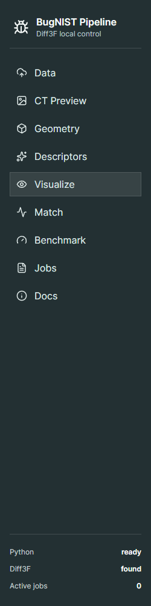
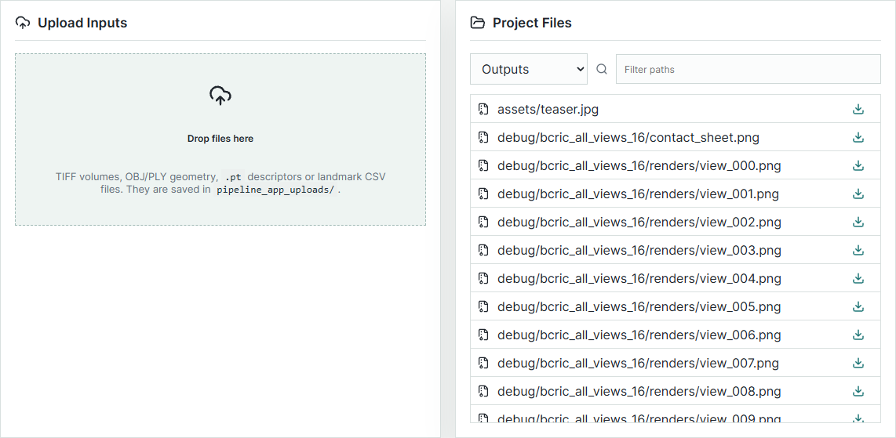
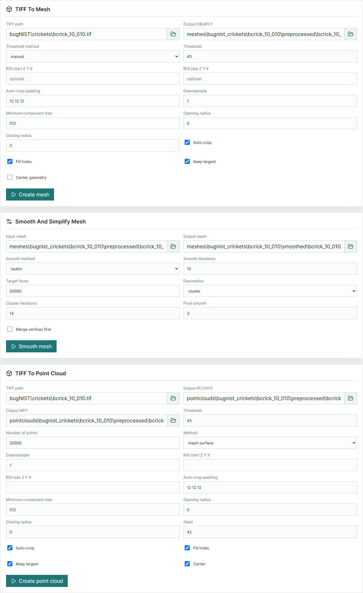
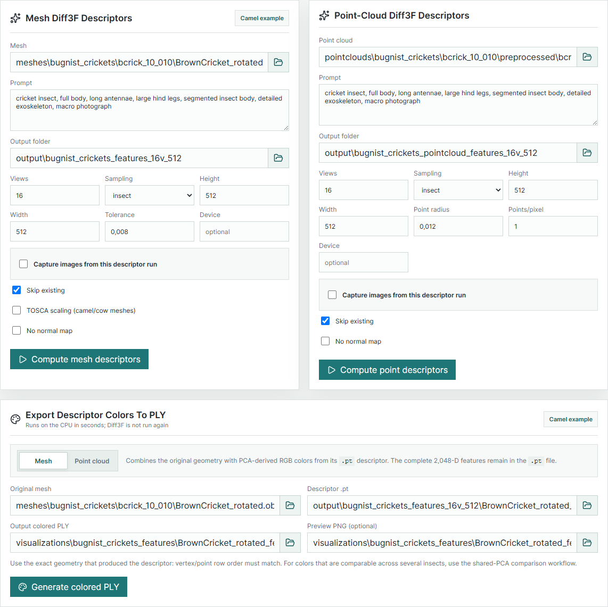
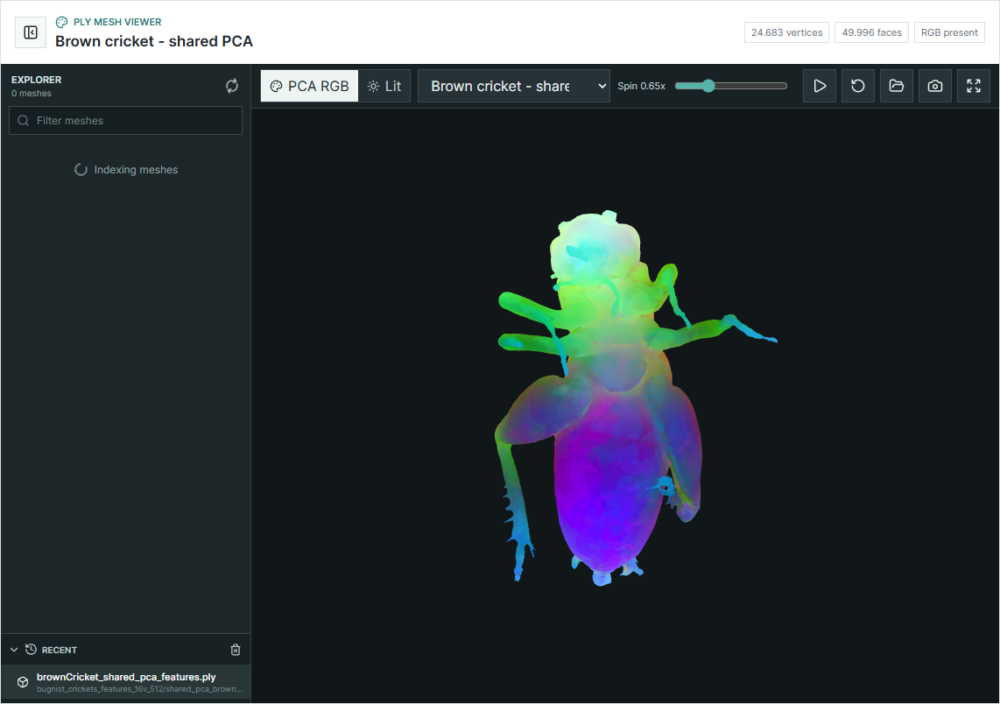
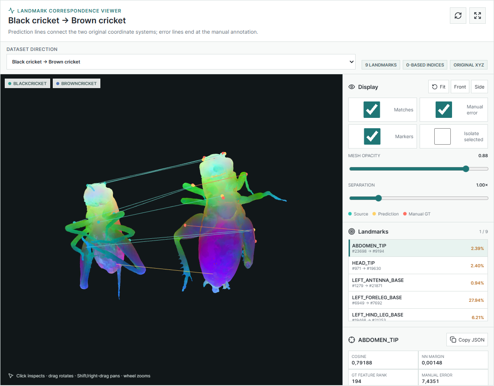
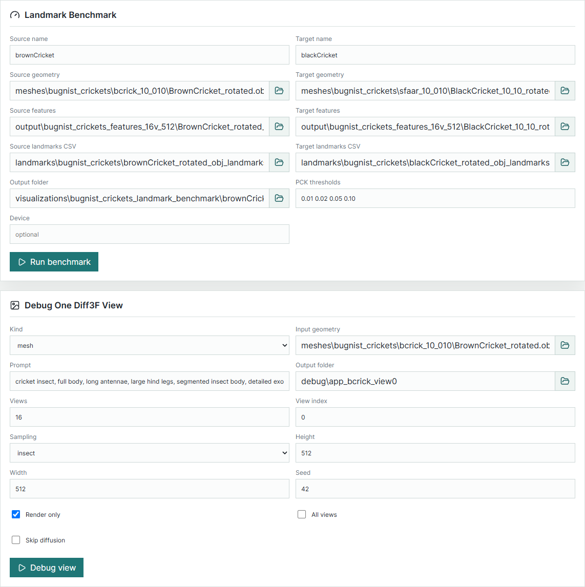

# User guide

Start the app with `npm run dev` and open <http://127.0.0.1:5180>. The sidebar tells you
whether the backend was found:

*Python: ready* and *Diff3F: found* mean jobs can run. If Python says *check*, the app did
not find the `diff3f` conda environment; set `DIFF3F_PYTHON` (see the README) and restart.

## A first test: the camel

The backend ships a camel mesh, so this works before you have any BugNIST data. It checks
that the GPU, the models and the viewers work.

1. Open **Descriptors** and press **Camel example** on the *Mesh Diff3F Descriptors* card.
   It fills in `meshes\camel.obj`, a camel prompt, 4 views at 256 x 256 and turns on image
   capture.
2. Press **Compute descriptors + capture images**. The app switches to **Jobs**, where the
   log appears. The first run downloads about 5.5 GB of models; after that a run like this
   takes about a minute, most of it loading the models.
3. When the job says *completed*, go back to **Descriptors**, press **Camel example** on the
   *Export Descriptor Colors To PLY* card and then **Generate colored PLY**.
4. Open **Visualize > Mesh viewer**, type `camel` in the Explorer filter and click
   `camel_diff3f_pca.ply`. Similar colours mean similar descriptors, so the colours should
   change smoothly over the body rather than look like noise.

The images of the run (render, depth, normals, generated image per view) are under
`debug/descriptor_runs/camel/`, and the Jobs page has download links for them.

## A full run: one cricket

The forms come pre-filled with the settings used for the brown cricket `bcrick_10_010`, so a
run is mostly pressing the buttons in order.

1. **Data.** Put the scan in the backend's `bugNIST/crickets/` folder, or drop it on the
   upload box (uploads go to `pipeline_app_uploads/`; click a file in the list to copy its
   path).
2. **CT Preview.** Run it with threshold 45. Download the output folder from the Jobs page
   and look at the `_overlay_` images: the insect should be red, the cotton not. Change the
   threshold and run again until it is right.
3. **Geometry > TIFF To Mesh.** Same threshold, *Auto-crop*, *Fill holes* and *Keep
   largest* on. About 120k vertices come out.
4. **Geometry > Smooth And Simplify Mesh.** The defaults (Taubin 10, 50,000 faces, final
   smoothing 3) bring it to about 25k vertices.
5. **Rotate** the smoothed mesh in Blender to the same pose as your other specimens (import,
   rotate, *Object > Apply > Rotation*, export as OBJ). Use the exported file from here on.
6. **Descriptors.** Select the rotated mesh (several meshes can go into one job, separated
   by spaces), keep the cricket prompt, 16 views, `insect` sampling, 512 x 512. This is the
   long step: about 5 minutes per mesh on a laptop GPU.
7. **Visualize.** Export the PCA colours and look at them in the mesh viewer.
8. **Match** and **Benchmark** once you have a second specimen and, for the benchmark,
   landmark CSVs from Blender (see the backend's pipeline guide).

## Pages

### Data

The upload box accepts TIFF, OBJ, PLY, `.pt` and CSV files. *Project Files* lists files in the
backend folder by type (up to 700); click a path to copy it into the clipboard, or use the
arrow to download the file.

### Path fields

Every path field can be typed into or filled with the folder button, which opens a browser
of the backend folder filtered to the right file types. Paths are relative to the backend
folder. Fields that take several files (for example the descriptor *Mesh* field) separate
them with spaces, so avoid spaces in file names. Output paths may point outside the backend
folder; the job still runs, but the Jobs page cannot offer a download link for it.

### CT Preview, Geometry, Descriptors

One card per script; the fields are the script's options with the same names. The backend's
[pipeline guide](https://github.com/pabloArce2/bugnist-diff3f-features/blob/main/docs/pipeline.md)
explains each of them. Two things are specific to the app:

- **Skip existing** on the descriptor cards skips meshes whose `.pt` already exists. It is
  disabled while *Capture images* is on, because captured images must come from the same run
  as the descriptor.
- **Export Descriptor Colors To PLY** needs the exact geometry the descriptor was computed
  from; the job fails with a row-count error otherwise.

### Visualize: mesh viewer

Opens OBJ and PLY files, from the project (Explorer on the left, or the preset list) or from
your computer (folder button, or drag and drop onto the view).

- **PCA RGB** shows vertex colours exactly as stored; **Lit** adds shading, which shows the
  shape better but changes the colours.
- The play button spins the model; the slider sets the speed.
- The camera button saves the current view as PNG.
- **Recent** remembers project files between sessions (in the browser's local storage).

### Visualize: correspondences

Shows a landmark benchmark: the source specimen on the left, the target on the right, and for
every landmark a line from the source point to the predicted point (turquoise) and a line from
the prediction to the hand-placed target (orange: the error).

- **Dataset direction** picks the benchmark. Directions are computed separately, so A -> B
  and B -> A are different datasets.
- **Landmarks** lists each landmark with its error as a percentage of the target's
  bounding-box diagonal. Selecting one shows its cosine score, the margin to the second-best
  match, the rank of the true target among all target vertices, and which PCK thresholds it
  passes. *Isolate selected* hides the other lines.
- **Point inspector**: click anywhere on a mesh to see the exact surface point, the nearest
  vertex and its index (the row of that vertex in the `.pt` file), or type an index and press
  *Go*. *Copy JSON* copies the details. Escape clears the selection.
- **Direction summary** has the averages and PCK of the whole direction.

New datasets appear here when their `correspondence_presets.json` is in the backend's
`visualizations/` folder; see [correspondence-datasets.md](correspondence-datasets.md).

### Match and Benchmark

*Feature Correspondences* matches sampled points of one specimen to another and writes a
CSV; *Blender Correspondence Scene* turns that CSV into a `.blend` file. *Landmark Benchmark*
runs the evaluation for one direction; add its result to the correspondence viewer to look
at it. *Debug One Diff3F View* runs a single camera view and saves every intermediate image:
*Render only* stops after the render (with *All views*, for every camera), *Skip diffusion*
after the ControlNet inputs.

### Jobs

Every job keeps its full command line, its log and links to its outputs (folders download as
zip). *Stop* ends a running job. Jobs live in the server's memory, so the list is empty after a
restart; the files the jobs wrote stay.

## Mouse and keyboard in the 3D views

| Action | Does |
| --- | --- |
| left-drag | rotate |
| Shift + left-drag, right-drag, middle-drag | pan |
| wheel | zoom towards the cursor |
| F | fit the model in the view |
| click (correspondence viewer) | inspect the point |
| Esc (correspondence viewer) | clear the inspected point |
| Space (mesh viewer) | start or stop spinning |

## When something goes wrong

- **A job fails straight away.** Open it on the Jobs page: the log shows the command and the
  Python error. The most common one is a row-count mismatch between a mesh and a `.pt` file.
- **"Path is outside the Diff3F folder".** Downloads and the file browser only work inside
  the backend folder. Move the file there, or set `DIFF3F_ROOT`.
- **The 3D view stays black.** The browser has WebGL disabled; try another browser or enable
  hardware acceleration.
- **"No correspondence datasets were found".** There is no `correspondence_presets.json`
  under `visualizations/` yet.
- **Port 5180 is in use.** Start with another port: `PORT=5181 npm run dev` (PowerShell:
  `$env:PORT=5181; npm run dev`).
